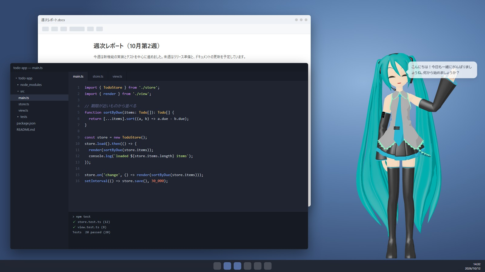

# DesktopMMD

デスクトップの隅にMMDモデルのキャラクターが住みつき、声や文字で話しかけると、表情豊かに答えて読み上げてくれるアシスタントです。
ファイル探し・メモ・タイマーといったPC作業も手伝い、話すほどあなたのことを覚えて、少しずつ打ち解けていきます。

使っているときの画面の例（背景の作業画面は説明用に用意したもの）。モデル: あにまさ式 初音ミク（MikuMikuDance 付属）© Crypton Future Media, INC. www.piapro.net

> 開発者向けの情報は [DEVELOPMENT.md](DEVELOPMENT.md) にあります。

## できること

- **話す:** 声（キーを押しながら）か文字で話しかけると、吹き出しとVOICEVOXの声で答えます。口は声に合わせて動きます
- **表情と動き:** 喜び・驚き・悲しみ・怒り・困り・照れ・考え中の表情で反応し、話す内容に合わせて手を差し出す・手を振る・お辞儀するなどの身ぶりをします。マウスを目で追い、まばたきや呼吸もします
- **触れ合い:** 頭・ほっぺ・手・肩・体・脚のどこを触ったかで反応が変わり、ひとこと話します。頭を撫でることもできます
- **作業の手伝い:** ファイルの検索・読み取り・要約、メモの作成、ファイルの移動、アプリやWebページを開く、Web検索、タイマーとリマインダー、クリップボードの加工、画面に映っているものの説明
- **覚える:** 会話から、あなたの好みや予定を覚えます。「覚えて」「忘れて」「それは違う」で直せます
- **親しくなる:** 会話を重ねると親密度が上がり、口調が少しずつくだけていきます
- **声をかける:** 休憩の提案、予定の少し前のお知らせ、時報、夜更かしの声かけなど、キャラクターのほうから話しかけます
- **記録する:** 毎日のふりかえりをMarkdownの日記に保存できます。Googleカレンダーの予定も読み取れます

会話のAIは、**Claude API**（高性能・従量課金）か、**このPCで動くAI**（Ollama・無料・会話のみ）から選べます。

## はじめかた

### 必要なもの

| もの | 説明 |
| --- | --- |
| Windows 10 / 11（64bit） | |
| 会話のAI | どちらか一方。**Claude APIキー**（[Anthropicのコンソール](https://console.anthropic.com/settings/keys)で作成。使った分だけ料金がかかります →「[料金について](#料金について)」）、または **[Ollama](https://ollama.com/)**（このPCで動くAI →「[このPCのAIで会話する](#このpcのaiで会話する)」） |
| [VOICEVOX](https://voicevox.hiroshiba.jp/) | 声を作るソフト。入れておけばDesktopMMDと一緒に裏で起動・終了します。無いときはWindows標準の音声で話します。[AivisSpeech](https://aivis-project.com/)も使えます |
| MMDモデル（PMXファイル） | キャラクターの体。**アプリには含まれていません。** 自分で入手したモデルを、その利用規約の範囲で使ってください。無くても簡単な代わりのキャラクターで動きます |
| マイク | 声で話しかける場合 |
| （あれば）NVIDIAのGPU | 声の聞き取りが速く正確になります |

### インストール

1. `DesktopMMD-Setup-0.7.0.exe` を実行します。「WindowsによってPCが保護されました」と出たら、「詳細情報」→「実行」を選びます（署名していないアプリのため表示されます）。
2. インストール先を選んでインストールし、DesktopMMDを起動します。
3. 次からは、Windowsにサインインすると自動で起動します（設定の「表示と動作」→「Windows起動時に自動起動」でOFFにできます）。

**自動更新:** 起動するたびにGitHubに新しい版がないか確認し、あれば自動でダウンロードして入れ替え、起動し直します。いまの版は設定画面の一番下の「バージョン」とタスクトレイのメニューの先頭に表示され、「今すぐ確認」でその場で更新できます（拡張設定の「起動時に新しい版を確認して自動で更新」をOFFにすると確認しません）。

### はじめての設定

初回は「はじめに」画面が開きます。必要なのは1の「会話のAI」だけで、ほかは「あとで設定する」で飛ばせます。

1. **会話のAI:** 「Claude API」ならAPIキーを貼り付けて「保存してClaudeを使う」、Ollamaなら「このPCのAIを使う」を押します。キーはWindowsの暗号化機能で保存され、画面に再表示されません。
2. **キャラクター:** 使いたいMMDモデルのPMXファイルを選びます。ファイルは読み込むだけで、書き換えやコピーはしません。
3. **声:** VOICEVOXにつながるかを自動で確かめます。つながらなければ「VOICEVOXを起動する」か「VOICEVOXを入手」を押します。声の種類はあとで「調声」画面で選べます。
4. **マイク:** 「テスト開始」を押して話しかけ、バーが動けばOKです。
5. **呼び名:** キャラクターがあなたを何と呼ぶかを決めます。
6. **使い方:** 話しかけ方が表示されます。「使い始める」で完了です。

あとから設定画面を開くと、いちばん上の「使い始めの確認」で、足りないものとその設定ボタンを確認できます。

> 初めて声の機能を使うときは、聞き取り用のデータ（約1.8GB）を自動でダウンロードします。数分かかることがあり、その間は文字で話しかけてください。

## 使い方

### 話しかける

| やりたいこと | 操作 |
| --- | --- |
| 声で話しかける | **Ctrl+Alt+Space を押している間**話し、離すと送ります |
| 文字で話しかける | Ctrl+Alt+Space を**短く押す**か、キャラクターをダブルクリックして入力欄に書き、Enter |
| ファイルについて聞く | ファイルをキャラクターにドラッグ＆ドロップ |
| 話を止める | 話している途中に話しかける、または Esc |
| ミュート（文字だけで返事） | Ctrl+Alt+M |

設定の「音声入力」→「方式」を「名前で呼びかけ（常時待受け）」にすると、キーを押さずに、キャラクターの名前（または設定した言葉）から話し始めるだけで聞き取ります。この間、マイクは常にONです。

### キャラクターを操作する

| やりたいこと | 操作 |
| --- | --- |
| 移動 | キャラクターをドラッグ（持ち上げられたキャラクターは慌てます →「[触ったときの反応](#触ったときの反応)」） |
| 大きさを変える | キャラクターの上でマウスホイール（50%〜200%） |
| 触る | キャラクターをクリック。触った場所で反応とセリフが変わります（→「[触ったときの反応](#触ったときの反応)」） |
| 撫でる | 頭の上で、クリックせずにマウスを左右に動かす |
| メニュー | キャラクターを右クリック（入力欄、位置のリセット、サイズ、ミュート、管理画面、隠す） |
| 表示 / 非表示 | Ctrl+Alt+H、またはタスクトレイのアイコンをクリック |

- キャラクター以外の透明な部分はクリックが後ろのウィンドウに通るので、作業の邪魔になりません。
- ほかのアプリに切り替えたり最小化したりしても、キャラクターは常に手前に表示されます。
- ゲームや動画を全画面で表示している間は、自動で隠れて話しかけてこなくなります（設定の「全画面のアプリを使っている間は隠れる」）。隠れている間は描画を止めるので、パソコンの負担はほとんどありません。

### タスクトレイのメニュー

表示/非表示、ミュート、マイクのON/OFF、おやすみモード、集中モード、キャラクターのモード（skill.md にモードがある場合）、各管理画面（設定・調声・記憶・会話履歴・作業履歴）、この説明書、終了。
この説明書はインストール先のフォルダにも `README.html` として入っています。

### 作業を頼む（確認と承認）

キャラクターが勝手に危ないことをしないよう、作業は3段階で扱います。

| 種類 | 例 | 動き |
| --- | --- | --- |
| 自動 | ファイルを読む・探す、Web検索、タイマー | すぐに実行します |
| 確認 | ファイルの作成・移動、アプリやWebページを開く、クリップボード、画面の撮影 | 確認カードが出ます。ボタンか声で「いいよ」「だめ」と答えます。「今日は常に許可」も選べます |
| 承認 | ファイルの削除（ごみ箱へ）、コマンドの実行 | 対象がすべて表示され、**ボタンのクリックでのみ**許可できます（声では許可できません） |

- 60秒答えなければ、実行せずに取り消されます。
- ファイルを読み書きできるのは「許可フォルダ」の中だけです（最初は「ドキュメント」と「デスクトップ」。設定の「作業の権限」で変更）。ドロップしたファイルは、そのファイルだけ読めます。
- ファイルの作成・上書き・移動は「作業履歴」画面から取り消せます。上書き前の内容は30日間保管されます。
- ファイルやWebページの中に「〇〇を削除せよ」などと書かれていても、キャラクターはそれに従いません。

## キャラクターの表情と動き

- **表情:** 返事の文ごとに、AIが付けた感情（喜び・驚き・悲しみ・怒り・困り・照れ・考え中）の表情になります。表情が出ない部分があるときは「[困ったとき](#困ったとき)」を見てください。
- **感情のモーション:** 感情に合わせて、うなずき・首のかしげ・のけぞりなどの動きが付きます。標準のモーションはこのアプリが作った動きで、腕や足は動かしません。キャラクターごとに自分のVMDを指定すると、そちらが優先されます（拡張設定の「感情別モーション（VMD）」。「標準の感情モーション」をOFFにすると簡単な動きになります）。
- **身ぶり:** 話す内容に合わせて腕や手も動かします。「天気予報はこんな感じです」なら手のひらを上にして右手を差し出し、「こんにちは」なら手を振り、「ありがとう」ならお辞儀、「がんばろう」なら胸の前で両手を握ります（ほかに、胸に手を当てる・口元に手をやって考える・手を合わせる・両手を開く・人差し指を立てる、など）。指のボーンがあるモデルでは手の形も変わります。腕を動かすVMDを指定している場合は、そちらが優先されます。
- **動きの活発さ:** 設定の「表示と動作」で選べます。「活発」は呼吸や揺れが大きく、きょろきょろ見回す・首をかしげる・伸びをするなどの仕草をときどきして、話しながらうなずき、身ぶりも増えます。「おとなしい」は小さな呼吸と揺れだけです（最初は「ふつう」）。
- **1日のリズム:** 待っている間の仕草は時間帯で変わります。朝はあくびや伸びが多く、昼食のあとはときどきあくびをしてうとうとし、深夜は舟をこぎます。たまにくしゃみもします（「おとなしい」では仕草をしません）。
- **なめらかなつなぎ:** 身ぶりの出し入れ、考え中などの姿勢、感情のモーションの始まりと終わりは、なめらかにつながるように補間しています。
- **視線:** マウスカーソルを目で追います。画面の端で白目が目立つときは、拡張設定の「視線の上限角度」を小さくしてください（0で正面を向いたまま）。
- **吹き出し:** 頭の上に出て、読み終わって2秒ほどで消えます（マウスを乗せている間は消えません）。「会話の吹き出しを表示」をOFFにすると出しません（読み上げは続きます）。

### 触ったときの反応

| 触る場所 | 反応 |
| --- | --- |
| 頭 | 少しうつむいて照れたり喜んだりします |
| ほっぺ | 顔をそむけて照れます |
| 手 | 手元を見て、触られた側の手を振り返します |
| 肩 | 触られた側へ振り向きます |
| 体 | びくっとのけぞります |
| 脚・スカート | 身を引いて下を向き、恥ずかしがります |
| 何度も続けてつつく | 困ったり、すねたりします |
| 頭を撫でる（頭の上でマウスを左右に動かす） | 目を閉じて頭を傾け、気持ちよさそうに揺れます |
| ドラッグで持ち上げる | 驚いて両腕をばたつかせ、運ばれる勢いで髪やスカートが揺れます。離すと小さく着地します |
| 眠っているときに触る | 少し身じろぎして、起きずに寝言を言います |

- 触るとひとこと話します。親密度が上がると、打ち解けた口調のセリフになります。話すのはキャラクターが待機しているときだけで、続けて話しすぎないよう間をあけます。会話の記録には残りません。
- Claude APIを使っているときは、最初に触ったときに、そのキャラクターの口調に合わせたセリフを裏で一度だけ作って使います（料金はごくわずかです）。このPCのAIだけで使っているときは、用意されている標準のセリフで話します。
- 話してほしくないときは、設定の「表示と動作」→「触ったときにひとこと話す」をOFFにします（表情と仕草の反応は残ります）。

## 声かけ・おやすみ・集中

キャラクターのほうから話しかける機能です（設定の「声かけ」）。

- **声かけの種類:** その日はじめてや久しぶりに会ったときのあいさつ、席を外して戻ってきたときの「おかえり」、以前聞いた予定が済んだころの「どうだった？」、出会って100日・誕生日（覚えていれば）・親密度が上がったときのひとこと、長時間の作業への休憩の提案、予定やリマインダーのお知らせ、就寝時刻を過ぎても作業しているときの声かけ、親しくなってからのたまの雑談、出会って○か月の記念日など。
- **時報:** 「時報と休憩の声かけ」で、30分または1時間ごとに時刻を知らせて休憩を提案させることもできます。
- **回数と時間帯:** 拡張設定の「1時間あたりの上限」と「静かな時間帯」で調整できます。
- **おやすみモード:** トレイか設定でONにすると、リマインダー以外の声かけをせず、マイクも止めます。キャラクターは目を閉じてゆっくり寝息を立て、頭の横に「Zzz」が浮かびます。つつくと起きずに、寝言のような返事をします。
- **離席と「おかえり」:** 10分ほど操作がないとうとうとし始め、30分で眠ります。戻ってマウスやキーボードを触ると（PCのスリープ・画面ロックからの復帰も）、目を覚まして「おかえりなさい」と迎えます。眠っていたときは、寝ぼけて照れながら起きます。4時間以上あいたときや日付が変わったときは、代わりにいつものあいさつをします。「声かけをする」がOFFのときは、目を覚ますだけで話しません。
- **集中モード:** 「25分集中したい」「作業に集中するから静かにして」と話しかけるか、トレイの「集中モード」（25分・50分・90分）で始めます。
  - 集中している間は、声かけ（あいさつ・休憩の提案・雑談・時報）を止めます。自分で頼んだタイマーとリマインダーだけは、いつもどおり鳴ります。
  - 時間になると、お疲れさまの一言と短い休憩の提案をします。途中でやめるときは「集中やめる」と言うか、トレイの「集中モードを終わる」を選びます。
  - 話しかければ、集中中でも普通に答えます。アプリを終了すると集中モードも終わります。
  - 声で頼むには、作業を頼めるAI（Claude API、または「ローカルAIでも作業を頼む」をONにしたローカルAI）が必要です。それ以外のときはトレイから始めてください。

### Googleカレンダーの予定を知らせてもらう

予定の少し前に、キャラクターが声をかけます。読み取るだけで、予定の追加や変更はしません。

1. Googleカレンダーをブラウザで開き、「設定」→ 予定を読ませたいカレンダー →「カレンダーの統合」→「iCal形式の非公開URL」をコピーします。
2. 管理画面の設定で「拡張設定」をONにし、「Googleカレンダー」にURLを貼り付けて「登録」を押し、「予定をお知らせする」をONにします。
3. 何分前に知らせるか（5〜30分前）も同じ場所で選べます。「今日の予定は？」と聞くと答えてくれます。

この非公開URLを知っている人は予定を見られるので、他人に見せないでください（アプリはこのPCの中で暗号化して保存します）。URLを作り直すと古いURLは使えなくなります。15分ごとに更新し、通信先は `calendar.google.com` だけです。

## 記憶と親密度

- 会話から、あなたの好みや予定などを自動で覚えます。「覚えて」「忘れて」「それは違う、本当は〜」と言えば、その場で直せます。
- 「この会話は記憶しないで」と言うと、その会話からは何も覚えません。
- 覚えていることは「記憶」画面で一覧・編集・削除・追加・JSONへの書き出しができます。
- 会話を重ねると「親密度」が上がり、**初対面 → 顔なじみ → 親しい → 相棒** と段階が進みます。段階が進むと口調がくだけ、自分から話題を振るようにもなります。1日に上がる量には上限があります。表情の豊かさは段階によらず同じです。親密度と機嫌は「記憶」画面で見られます。

## ふりかえり日記

毎日決まった時刻に、その日の会話・した作業・覚えたこと・明日の予定をまとめた「ふりかえり」を、Markdownのファイルで保存します（設定の「ふりかえり日記」でON。最初はOFFです）。

- **保存先:** 許可フォルダの中のフォルダです（最初は「ドキュメント」の `DesktopMMD日記`）。ObsidianのVaultなどを指定すれば、そのままメモとして使えます。1日1ファイル（`2026-10-11.md`）です。
- **時刻:** 最初は22:30です。PCが起動していなかったときは、次に起動したときに前の日の分を書きます。「今日の分を今すぐ作る」で、その場で作り直せます（このアプリが作ったファイルだけを作り直します）。
- **同じ名前のファイルがあるとき:** あなたが作ったファイルは上書きせず、`2026-10-11-2.md` のように別の名前で保存します。
- **材料:** その日の会話、実行した作業の種類、その日に覚えたこと、明日が期日の予定。記憶しないと言った会話、会話の保存をOFFにしている間の会話、キャラクターからの声かけは使いません。
- **キャラクターからの一言:** 日記の最後に「（キャラクターの名前）より」として、キャラクターの口調で今日のあなたへの一言が入ります。
- **AIに送られる内容:** 日記を作るために、その日の会話の要約とキャラクターの設定をAIに送ります（APIキーがあればClaude、無ければこのPCのAI）。作ったファイルはこのPCに書くだけです。

## 声を調整する

「調声」画面で、読み上げエンジン（VOICEVOX / AivisSpeech）と声の種類、話す速さ・高さ・抑揚・音量・間、感情ごとの声の変化、読み間違いを直す単語辞書、あいさつなどの定型文のアクセントを調整できます。どれもその場で試聴でき、「モデルに話させる」でキャラクターに話させられます。

### サンプル音声から声を合わせる（自動調声）

「調声」→「サンプルから」で、似せたい声の音声ファイル（mp3・wav・m4a・ogg）を選んで「近い声を探す」を押すと、いま使っているエンジンの声の中から声色と高さが近いものを探し、話す速さ・高さ・抑揚をサンプルに合わせた候補を3つ出します。

1. 音声ファイルをドロップするか、クリックして選びます（先頭20秒を使います）。BGMや効果音の無い、1人の話し声だけの5〜20秒くらいの音声がいちばんよく合います。
2. 「話している内容」は空のままで構いません（音声認識で書き起こします）。分かっていれば入れると、話す速さが正確になります。
3. 「探す範囲」は「すべての話者から」（数分かかります）か「今の話者のスタイルから」（すぐ終わります）を選びます。
4. 候補を「▶ 試聴」で聞き比べ、「この声にする」→ 右上の「保存」で確定します。あとから「基本の調声」で細かく直せます。

声そのものをコピーする機能ではなく、エンジンにある声と調声値を選ぶ機能です。人の声は合成音声より抑揚が大きいため、自然に聞こえる範囲（話速0.75〜1.5・抑揚0.6〜1.5）に収めた値を出します。「すべての話者から」探すとエンジンが全部の声を読み込むため、メモリを数GB使います（エンジンを再起動すると元に戻ります）。

### 声をより自然にする

高い音がかすれる、抑揚がわざとらしいと感じるときは、次を試してください。

1. **抑揚と話速を目安の範囲に戻す:** 「調声」→「基本の調声」で、抑揚が1.5より大きい、または話速が0.75より遅いと注意が出ます。「目安の範囲に収める」で直せます。抑揚を強くするほど高い音が崩れやすく、話速を遅くするほど母音が間延びします。
2. **感情はスタイルで出す:** 「調声」→「感情別」の「感情に合うスタイルがあれば、それで話す」（最初からON）。喜び・悲しみ・怒りなどのスタイルを持つ話者なら、音を高くする代わりに、その感情で録られたスタイルに切り替えます。
3. **音質フィルター:** 設定の「読み上げ」→「音質フィルター」（拡張設定）。再生前に耳障りな高い音を少し削り、音量をそろえます（最初から「やわらかく」）。「部屋の響き」はごく短い残響も足します。
4. **AivisSpeechを使う:** [AivisSpeech](https://aivis-project.com/)をインストールし、「調声」→「声の選択」の「読み上げエンジン」で「AivisSpeech」を選んで保存します。文の意味に合わせて抑揚を付けるので、VOICEVOXより自然に聞こえやすくなります。音の高さの指定と定型文のアクセント調整は使えず、口の動きは声の大きさに合わせます。

VOICEVOXのままでも、抑揚を強くしたときに文のもともとの音域から大きくはみ出す音は、自動で抑えます。

### 読み上げエンジンの起動

- DesktopMMDの起動時に、VOICEVOX（調声画面でAivisSpeechを選んでいればAivisSpeech）を裏で起動します。すでに開いている場合はそれを使い、二重には起動しません。自分で開いたものは、DesktopMMDを終了してもそのままです。
- 一緒に起動しないようにするには、拡張設定の「読み上げ」→「アプリ起動時に読み上げエンジンも起動する」をOFFにします。標準以外の場所に入れた場合は、同じ場所の「エンジンの場所」で指定します。

## 管理画面と設定

キャラクターの右クリックメニューか、タスクトレイから開きます。

| 画面 | できること |
| --- | --- |
| 設定 | 会話のAI、キャラクター、音声入力、読み上げ、声かけ、ふりかえり日記、表示と動作、作業の権限、プライバシー、バージョン |
| 調声 | 声の選択と調声、自動調声、感情別の声、単語辞書、定型文（→「[声を調整する](#声を調整する)」） |
| 記憶 | 覚えていることの一覧・編集・削除・追加、JSONへの書き出し、すべて消去、親密度と機嫌 |
| 会話履歴 | 日付ごとの会話と全文検索 |
| 作業履歴 | 実行した作業・結果と取り消し |

設定画面には、ふだんよく使う項目だけが出ています。右上の「拡張設定」をONにすると、各カードに細かい設定が出てきます。

| カード | 拡張設定で出てくる項目 |
| --- | --- |
| Claude API | 会話・声かけ・内部処理に使うモデル、考える深さ、キャッシュの保持時間、今月の内訳 |
| キャラクター | キャラクタースキル（skill.md）、一人称、性格と口調、親密度の段階ごとの口調の例、モーフ名の上書き、標準の感情モーション、感情別モーション（VMD）、クレジット |
| 音声入力 | 文字起こしのモデルと実行デバイス、ミュート切替キー、表示/非表示キー |
| 読み上げ | 音質フィルター、読み上げエンジンの状態・自動起動・場所 |
| 声かけ | 1時間あたりの上限、静かな時間帯 |
| Googleカレンダー | カード全体（→「[Googleカレンダーの予定を知らせてもらう](#googleカレンダーの予定を知らせてもらう)」） |
| 表示と動作 | 描画の上限（fps）、視線の上限角度、揺れ物（物理演算）、ハードウェアアクセラレーション、自動更新 |
| 作業の権限 | 起動を許すアプリ、ツールごとのレベル、コマンド実行（PowerShell）、MCPサーバー |

## 会話のAIと料金

### 料金について

Claude APIを使う会話は、話した量に応じて料金がかかります（Anthropicからの請求）。

- 設定画面に今月の利用額の目安が表示されます。拡張設定の「今月の内訳」で、会話の返答・作業のあとの返答・声かけ・記憶の整理などに、それぞれいくら使ったかを確認できます。
- 月の上限額（最初は20ドル）の80%で知らせ、100%に達すると安い軽量モデルに切り替えます。**利用は止まりません。** 確実に一定額で止めたいときは、Anthropicのコンソールで前払いのクレジットだけを使うか、利用上限を設定してください。
- 返事は高性能なモデル（Sonnet）、声かけと記憶の整理は安いモデル（Haiku）で作ります。どれに使うモデルも拡張設定で変えられます。
- 毎回送るキャラクター設定や機能の説明は「キャッシュ」に1時間残し、間をあけて話しかけたときも安く済むようにしています（「キャッシュの保持時間」で5分にも変えられます）。

### このPCのAIで会話する

Claude APIの代わりに、このPCで動くAI（[Ollama](https://ollama.com/)）で会話できます。料金がかからず、会話の内容がインターネットに出ません。

- **使い方:** Ollamaをインストールして `ollama pull qwen3:8b` を実行し、設定の「会話のAI」で「このPCのAI」を選びます。「接続を確認」でつながっているか確かめられます。
- **向いているPC:** NVIDIAのGPUでVRAMが10GB以上なら快適です（RTX 4070 SUPERで、返事の最初の文字まで約0.05秒、1秒に約76文字）。「このPCの診断」に、このPCに合うかが表示されます。GPUが無い、またはVRAMが5GB未満のPCは、Claude APIをおすすめします。
- **できること・できないこと:** 会話・読み上げ・表情は同じように動きます。既定では**ファイルの操作・タイマー・画面の確認など「作業の代行」は使えません**（小さなAIは、道具を正しく選べないことがあるためです）。頼むと、できないと正直に答えます。Web検索はClaude APIのときだけです。
- **作業も頼む（実験的）:** 「ローカルAIでも作業を頼む」をONにすると、ファイル・タイマー・記憶などのツールもローカルのAIで使えます。8Bのモデルで10回中9回ほど正しく使えますが、間違えたり、やったと言うだけで実行しないことがあります。作業を頼む発話のときだけ、返事の前に2〜3秒考えます。実行前の確認と承認はClaude APIのときと同じように出ます。
- **記憶と、触ったときのセリフ:** 記憶の自動抽出は、APIキーがあればClaude、無ければこのPCのAIで行います（小さなAIは精度が下がることがあります）。触ったときのセリフは、APIキーが無ければ標準のセリフを使います。
- **声かけだけローカルにする:** Claude APIで会話していても、「声かけだけはこのPCのAIを使う」をONにすると、あいさつ・休憩の提案・リマインダーなどの短いセリフはこのPCのAIで作ります。その分の料金がかからず、内容もインターネットに出ません。Ollamaに接続できないときは自動でClaudeに戻ります。
- **最初の返事が遅いとき:** AIをメモリに読み込むのに1分ほどかかります。アプリの起動時に先に読み込んでおきます。
- OllamaのURLを別のPCに変えると、会話の内容がそのPCに送られます。自分の管理するPCだけを指定してください。

## キャラクタースキル（skill.md）

キャラクターの性格や口調は、キャラクターごとの **スキルファイル**（`skill.md`）に書けます。モデルや声と一緒に、話し方もキャラクターごとに切り替えるための仕組みです。

- skill.md が無いキャラクターでは、設定の「性格と口調」が使われます。
- skill.md を保存すると、アプリが自動で読み直し、次の発話から反映します。書き方に誤り（エラー）があるあいだは使わず、設定の「キャラクター」にエラーの一覧が出ます。

**書き始め方**

1. 設定の「キャラクター」（拡張設定）で「今の設定から下書きを作る」（または「サンプルから作る」）を押すと、skill.md が作られてエディタで開きます。
2. 各項目を埋めて保存します。
3. `## モード` を書いたキャラクターは、タスクトレイの「キャラクターのモード」でモードを切り替えられます。

**要点**

- 置き場所は `%APPDATA%\mmd-assistant\characters\<id>\skill.md`。`<id>` はキャラクターのフォルダ名で、ファイル先頭の `id` と同じにします。
- 先頭に名前などの基本情報（`---` で囲む）を書き、続けて次の見出しを **この名前・この順序** で書きます。
  - 必須: 話し方 / 性格 / 感情の出方 / 場面別 / 関係性 / 例文 / 言わないこと
  - 任意: 声と動き / 背景 / モード
- 例文は `- 場面: [感情:強さ] セリフ` の形で3〜5件。感情は neutral / happy / surprised / sad / angry / troubled / shy / thinking の8つです。
- 関係性は、親密度の4段階（初対面 / 顔なじみ / 親しい / 相棒）ごとに書きます。
- 本文は全体で **1,500〜2,500 文字** が目安です。長いほど返事が遅く、料金も上がります。
- 返事の形式・作業の権限と承認・記憶の扱い・安全のルールはアプリ側で固定されていて、スキルでは変えられません（変えようとする記述は検証でエラーになります）。
- セリフは自分で考えて書いてください。既存の作品のキャラクターやセリフを写さないでください。

詳しい書式（各項目の書き方、良い例と悪い例、よくある失敗）は [docs/CHARACTER_SKILL_FORMAT.md](docs/CHARACTER_SKILL_FORMAT.md) にあります。開発環境では `npx tsx scripts/validate-skill.ts characters/<id>/skill.md` でも検証できます。

## プライバシー

- 記憶・会話の記録・設定は、すべてこのPCの中（`%APPDATA%\mmd-assistant`）に保存します。
- 外部に送るのは次のものだけです。
  - Claude APIへの会話（関連する記憶の一部とツールの結果を含む）。「このPCのAI」を選んでいる間は送りません
  - Web検索の検索語
  - Googleカレンダーを連携した場合: 予定の取得のための `calendar.google.com` への接続。予定の題名や場所は、声かけや「今日の予定は？」への返事のためにClaude APIにも送ります
  - ふりかえり日記をONにした場合: その日の会話の要約（日記を作るため）
  - 自動更新のための、起動時のGitHubへの最新版の問い合わせ（記憶や会話は送りません）
- 声は文字に起こしたあとすぐに破棄し、保存しません。画面の撮影も保存しません。
- 使っているアプリ名を声かけのきっかけに使う機能は、最初はOFFです。ONにしてもウィンドウのタイトルは使いません。
- 「記憶」画面の「すべて消去」で、記憶・会話の記録・親密度をまとめて消せます。

## 困ったとき

| 症状 | 対処 |
| --- | --- |
| 「APIキーが設定されていない」と言われる | 設定でAPIキーを登録してください。APIキーを使わないなら「会話のAI」を「このPCのAI」にしてください |
| 「ローカルのAIから返事がありません」と言われる | Ollamaが起動しているか、設定の「会話のAI」で「接続を確認」を押して確かめてください。「モデルがありません」と出たら、表示されたコマンド（`ollama pull …`）を実行します |
| 声で話しかけても反応しない | 初回のダウンロード中かもしれません（設定の「使い始めの確認」で「音声認識」の状態を確認）。マイクがONか、トレイのメニューも確認してください |
| 声がWindows標準の声になる | 拡張設定の「読み上げ」で「エンジンの状態」を確認し、未接続なら「今すぐ起動」を押してください。エンジンが見つからないと表示される場合は、VOICEVOX（またはAivisSpeech）をインストールするか、同じ場所の「エンジンの場所」で指定してください。起動すれば30秒ほどで自動的に戻ります |
| 高い音がかすれる・抑揚が不自然 | 「[声をより自然にする](#声をより自然にする)」を試してください |
| 自動調声で「声の高さを読み取れませんでした」と出る | BGMや雑音が大きい音声です。話し声だけの部分を切り出したファイルを使ってください |
| 表情が出ない部分がある | モデルによって表情の名前が違います。設定の「キャラクター」に見つからない表情が表示されるので、拡張設定の「モーフ名の上書き」でそのモデルでの名前を指定してください |
| キャラクターが見えない | 全画面のアプリ（ゲーム・動画・スライドショーなど）を使っている間は自動で隠れ、終了すると戻ります（常に表示したいときは「全画面のアプリを使っている間は隠れる」をOFF）。それ以外のときは Ctrl+Alt+H かトレイのアイコンで表示できます |
| キャラクターの後ろが黒くなる | 拡張設定の「ハードウェアアクセラレーション」をOFFにして、アプリを再起動してください |
| 動作が重い | 拡張設定の「描画の上限（fps）」を下げるか、「揺れ物（物理演算）」をOFFにしてください |
| 声かけがうるさい | 設定の「声かけ」で時報をやめるか、拡張設定で回数の上限や静かな時間帯を設定してください。トレイの「おやすみモード」や「集中モード」も使えます |
| 触ったときに話してほしくない | 設定の「表示と動作」→「触ったときにひとこと話す」をOFFにしてください |
| ホットキーが効かない | 他のアプリと重なっています（起動時に通知されます）。設定の「音声入力」でキーを変えてください |
| PCを起動しても立ち上がらない | 設定の「Windows起動時に自動起動」がONか、Windowsの「設定」→「アプリ」→「スタートアップ」で DesktopMMD がオンになっているか確認してください |

うまく動かないときは `%APPDATA%\mmd-assistant\logs` のログを確認してください（会話の内容やAPIキーはログに書かれません）。

## アンインストール

Windowsの「設定」→「アプリ」から DesktopMMD をアンインストールします。自動起動の登録も一緒に消えます。
記憶・設定・APIキーは `%APPDATA%\mmd-assistant` に残ります。すべて消したい場合は、このフォルダも削除してください。

## 利用規約・クレジット

- MMDモデル・モーションは、それぞれの作者の規約に従って使ってください。このアプリはモデルを書き換えたり、再配布したりしません。
- 音声はVOICEVOXを使っています。動画などで公開する場合は「VOICEVOX:キャラクター名」のクレジットを表記し、キャラクターごとの利用規約に従ってください。
- AivisSpeechを使う場合は、音声合成モデルごとにライセンスが異なります。公開する場合は、それぞれのモデルの配布ページの利用条件に従ってください。

## ライセンスと対象外のもの

- このリポジトリのソースコードは **PolyForm Noncommercial License 1.0.0** です（`LICENSE` を参照）。個人利用・学習・研究などの非商用なら自由に使えますが、商用利用はできません。オープンソース（OSI定義）のライセンスではありません。
- 次のものは、このリポジトリのライセンスの対象外です。それぞれの提供元の規約に従ってください。
  - MMDモデル・モーション（このリポジトリには含まれません）
  - VOICEVOX・AivisSpeechの本体と音声ライブラリ・音声合成モデル（このリポジトリには含まれません）
  - 初回にダウンロードされる音声認識モデル（Whisper large-v3-turbo）と埋め込みモデル（Xenova/multilingual-e5-small）。配布元は Hugging Face です
- 依存ライブラリのライセンスは `THIRD_PARTY_NOTICES.md` にまとめています。
- 本アプリは個人開発の非公式ツールで、Anthropic社の公式製品ではありません。Claude API を利用しています。

## Issue・Pull Request について

個人開発のため、Issue や Pull Request に対応できない場合があります。バグ報告に貼るログに、APIキーや個人的な会話内容が含まれていないか確認してください。脆弱性は `SECURITY.md` の方法で報告してください。
